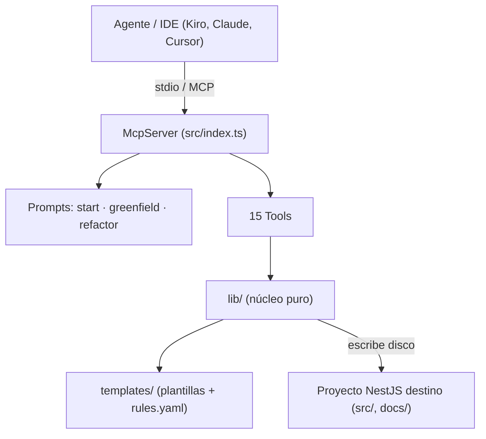
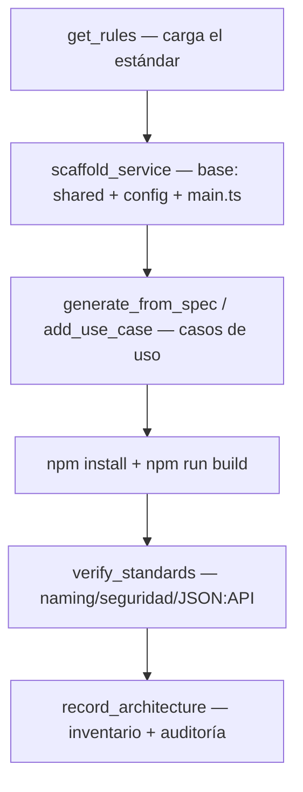
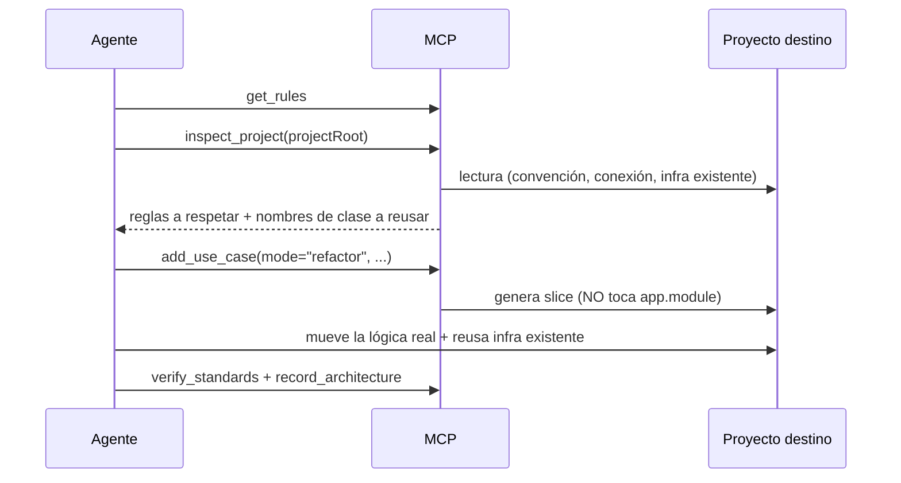
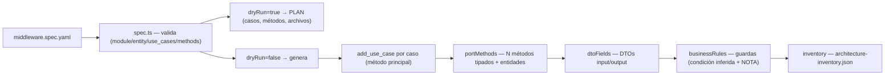

# midd-nestjs-hexagonal-architecture-mcp

> **Estado: híbrido en construcción.** Nace de combinar `midd-hexagonal-nestjs-mcp` (generador determinista)
> con las guidelines, el flujo agéntico y el escáner de `lib-midd-mcp-architecture`. Las decisiones, el porqué de
> cada regla, lo que ya se verificó y lo que falta están en [`docs/DESIGN.md`](docs/DESIGN.md). Donde este README
> (heredado) contradiga a `DESIGN.md` o a `templates/rules.yaml` v2, mandan estos dos: en particular la ruta
> `/{context}/api/v{N}/{resource}`, CORS sin `*`, y los tres controles de rate limit más correlation-id, ahora obligatorios.


Servidor **MCP** (Model Context Protocol) del área Middleware que **genera y verifica microservicios NestJS** con arquitectura **hexagonal**, contrato **JSON:API** y las **cabeceras de seguridad obligatorias**. Cualquier agente/IDE compatible (Kiro, Claude, Cursor, etc.) lo consume para crear servicios nuevos o refactorizar servicios existentes **apegados al estándar del área**, de forma agnóstica de dominio.

> Es la migración de la skill `middleware-hexagonal-nestjs` + su dataset de plantillas a un servidor MCP. La fuente de verdad del estilo es el repo canónico `midd-pf-enrollment`.

---

## Tabla de contenidos

1. [Descripción](#descripción)
2. [Arquitectura](#arquitectura)
3. [Diagramas](#diagramas)
4. [Capacidades](#capacidades)
5. [Stack tecnológico](#stack-tecnológico)
6. [Instalación](#instalación)
7. [Variables de entorno](#variables-de-entorno)
8. [Herramientas MCP (la "API")](#herramientas-mcp-la-api)
9. [Documentación interna](#documentación-interna)
10. [Testing](#testing)
11. [DevOps](#devops)
12. [Comandos](#comandos)
13. [Buenas prácticas](#buenas-prácticas)
14. [Mejoras sugeridas](#mejoras-sugeridas)
15. [Licencia](#licencia)

---

## Descripción

Este proyecto **no es un backend HTTP**: es un **servidor MCP sobre stdio** que escribe archivos directamente en un proyecto NestJS destino (modo A, "escribe disco"). Su "API" son **15 herramientas** (tools) y **3 prompts** (flujos) que un agente invoca para:

- **Crear** un microservicio NestJS hexagonal nuevo (greenfield) completo y funcional.
- **Refactorizar** un NestJS existente a arquitectura hexagonal, respetando su convención.
- **Generar módulos desde un spec declarativo** (`middleware.spec.yaml`), agnóstico de dominio.
- **Verificar** estándares (naming, seguridad, JSON:API) y **dejar memoria** por repo (inventario + auditoría).

El principio rector: **agnóstico de dominio, opinado en calidad**. El `module`/`entity`/`use_cases` los define el usuario; el MCP aporta la forma hexagonal, el naming, los puertos, el JSON:API y la seguridad, destilados del repo canónico.

---

## Arquitectura

El MCP es un proceso Node (ESM) que registra herramientas y prompts contra el `McpServer` del SDK oficial y se comunica por **stdio**. Internamente se separa en tres capas:

| Capa | Carpeta | Responsabilidad |
|------|---------|-----------------|
| **Entrypoint** | `src/index.ts` | Arranca el servidor, registra las 15 tools y los 3 prompts, conecta el transporte stdio. |
| **Tools** | `src/tools/` | Cada herramienta MCP: valida inputs (zod), orquesta la lib y devuelve un reporte de texto. |
| **Lib (núcleo)** | `src/lib/` | Lógica pura: sustitución de placeholders, materialización de plantillas, parcheo idempotente de módulos, parser de spec, inferencia de reglas, inventario. |
| **Dataset** | `templates/` | Las plantillas (capa `shared`, config, `_domain-slice`), `rules.yaml` y el template del spec. Se empaqueta con el servidor. |

**Patrón de generación:** las plantillas usan **placeholders case-sensitive** (`__Caso__`, `__caso__`, `__CASO__`, `__Request__`, `<sharedRoot>`, …) que se sustituyen por los nombres de negocio. Para lo que no se puede resolver con sustitución 1:1 (p.ej. N métodos por puerto, merge de casos, wiring SP), hay **enriquecedores programáticos** que parchean el código generado de forma **idempotente y quirúrgica** (anclados a marcas estables, nunca tocan lo ajeno).

```
src/
├── index.ts                 # servidor MCP: registra 15 tools + 3 prompts (stdio)
├── prompts.ts               # flujos guía: start, scaffold_greenfield, refactor_to_hexagonal
├── lib/
│   ├── dataset.ts           # localiza/lee plantillas y materializa árboles en el destino
│   ├── placeholders.ts      # sustitución case-sensitive + mapa de marcadores
│   ├── moduleMerge.ts        # merge del 2º/3er caso en los módulos del dominio existente
│   ├── spWiring.ts          # wiring quirúrgico del adapter SP (preserva forFeature)
│   ├── portMethods.ts       # enriquece puertos inbound/outbound a N métodos + entidades
│   ├── spec.ts              # parser + validador del middleware.spec.yaml
│   ├── businessRules.ts     # materializa reglas de negocio como guardas (condición inferida + NOTA)
│   ├── dtoFields.ts         # pobla DTOs input/output y entidades request/response desde el spec
│   ├── inventory.ts         # inventario (architecture-inventory.json) + auditoría (docs/audits)
│   ├── inspect.ts           # descubrimiento de solo lectura del proyecto (refactor)
│   ├── env.ts               # .env.example derivado del joiSchema
│   └── schemas.ts           # inputs zod compartidos
└── tools/
    ├── scaffold.ts          # scaffold_service
    ├── addUseCase.ts        # add_use_case (vertical slice; greenfield y refactor)
    ├── generateFromSpec.ts  # generate_from_spec (genera un módulo desde el spec)
    ├── architecture.ts      # record_architecture (inventario + auditoría)
    └── support.ts           # get_rules, inspect_project, verify_standards, list_templates, get_template
templates/
├── rules.yaml                       # cerebro de calidad agnóstico (lo devuelve get_rules)
├── middleware.spec.template.yaml    # plantilla del spec declarativo
├── config/                          # base del proyecto NestJS generado + enforcement
├── shared/                          # capa transversal (JSON:API, errores, logger, config, BD)
└── _domain-slice/                   # plantilla de un caso de uso hexagonal completo
test/                                # suite con el runner nativo de Node (node:test)
```

> **Nota de arquitectura — acoplamiento:** `generate_from_spec` reutiliza `add_use_case` como motor de siembra y luego aplica los enriquecedores (`portMethods`, `dtoFields`, `businessRules`) y el inventario. Es un acoplamiento deliberado y unidireccional (tools → lib), que mantiene el camino imperativo (`add_use_case`) intacto mientras el declarativo (`generate_from_spec`) se construye encima.

---

## Diagramas

### Arquitectura de componentes



### Flujo greenfield (crear servicio desde cero)



### Flujo refactor (NestJS existente → hexagonal)



### Generación declarativa desde spec



---

## Capacidades

### Generación (greenfield)
- `scaffold_service` siembra la **capa `shared` completa** (JSON:API, errores, logger, config + Joi, database-context, utils), los archivos de **config/enforcement** (eslint, prettier, Dockerfile, verify-standards, hooks husky), `main.ts` con **cabeceras de seguridad** y `app.module.ts` canónico, más el `.env.example` derivado del joiSchema.

### Vertical slice (greenfield y refactor)
- `add_use_case` genera un caso completo: **puertos inbound/outbound**, domain/application services, adapter (TypeORM por defecto; **SP opt-in**), controller JSON:API + DTOs, entidades de dominio y TypeORM, catálogos de error y los módulos del dominio.
- **Multi-caso:** al añadir el 2º/3er caso al mismo dominio, **mergea** el caso en los módulos existentes (controller, adapter, providers, tokens, `forFeature`) de forma idempotente.

### Generación declarativa (desde spec)
- `generate_from_spec` toma un `middleware.spec.yaml` y genera el módulo. Soporta **casos con N métodos por puerto** con entidades request/response tipadas. **Hexagonal puro:** la firma del método del puerto es siempre `(data: Request)` — el nombre del stored procedure NO viaja por el puerto (es infraestructura); el **adapter SP** lo resuelve internamente desde `ConfigurationVariables`. El branching de negocio se modela como métodos distintos del puerto. Materializa **DTOs input/output** y **reglas de negocio** (con condición inferida + NOTA para agentes y usuarios), y actualiza el inventario. `dryRun=true` (default) devuelve el **plan** sin escribir disco.

### Verificación y descubrimiento
- `verify_standards`: naming (bloquea typos como `,entity.ts`), cabeceras de seguridad, @Version, `.env.example` sincronizado, SP declarado.
- `inspect_project`: descubrimiento de **solo lectura** del proyecto destino (convención de carpetas, forma de la conexión TypeORM, infra transversal a reusar con sus **nombres de clase**).

### Memoria por repo
- `record_architecture`: inventario `docs/architecture-inventory.json` (una entrada por módulo, **sin tocar las de otros**) + auditoría `docs/audits/<module>-<fecha>.md`.

---

## Stack tecnológico

| Componente | Tecnología | Versión | Rol |
|------------|-----------|---------|-----|
| Runtime | Node.js | ≥ 18 (probado en 22) | Ejecuta el servidor MCP (ESM). |
| Lenguaje | TypeScript | ^5.4 | Código fuente (`src/`), compila a `dist/`. |
| Protocolo | `@modelcontextprotocol/sdk` | ^1.0.4 | `McpServer` + transporte stdio. |
| Validación | `zod` | ^3.23.8 | Esquemas de input de cada tool. |
| Parsing | `yaml` | 2.6.1 (pinned) | Lee el `middleware.spec.yaml`. |
| Tests | `node:test` | nativo | Suite sin dependencias extra. |
| Tipos | `@types/node` | ^20.11 | Tipos de Node para el build. |

> Las dependencias se documentan tal cual están en `package.json`. El MCP es deliberadamente ligero: solo SDK + zod + yaml en runtime.

---

## Instalación

```bash
npm install
npm run build
```

El dataset de plantillas vive en `templates/` y se empaqueta con el servidor (campo `files` del `package.json`: `dist` + `templates`).

### Conectar a Kiro

Añade el servidor a la config MCP. Workspace: `.kiro/settings/mcp.json`. Usuario: `~/.kiro/settings/mcp.json`.

```json
{
  "mcpServers": {
    "midd-hexagonal-nestjs": {
      "command": "node",
      "args": ["C:/Propuestas/midd-hexagonal-nestjs-mcp/dist/index.js"],
      "disabled": false,
      "autoApprove": []
    }
  }
}
```

Tras guardar, reconecta el servidor desde la vista MCP de Kiro (o reinicia). Las 15 herramientas y los 3 prompts aparecerán disponibles.

---

## Variables de entorno

El **servidor MCP en sí no requiere variables de entorno**. Las variables documentadas aquí son las del **servicio NestJS que el MCP genera** (derivadas del `joiSchema` del dataset, que es la fuente de verdad y alimenta el `.env.example`).

| Variable | Tipo | Requerida | Descripción |
|----------|------|-----------|-------------|
| `PORT` | number | sí (default 3000) | Puerto HTTP del servicio generado. |
| `DB_<CONEXION>_HOST` | string | sí | Host de la BD de esa conexión (p.ej. `DB_CATALOG_HOST`). |
| `DB_<CONEXION>_PORT` | number | sí | Puerto (default del motor: mssql 1433, postgres 5432, mysql 3306). |
| `DB_<CONEXION>_USERNAME` | string | sí | Usuario de BD. |
| `DB_<CONEXION>_PASSWORD` | string | sí | Contraseña de BD. |
| `DB_<CONEXION>_NAME` | string | sí | Nombre de la base de datos. |
| `<NOMBRE_SP>_SP` | string | condicional | Se añade automáticamente por cada caso con adapter `sp`. |

`.env.example` generado para un servicio nuevo:

```dotenv
PORT=3000
DB_CATALOG_HOST=localhost
DB_CATALOG_PORT=1433
DB_CATALOG_USERNAME=sa
DB_CATALOG_PASSWORD=changeme
DB_CATALOG_NAME=MyDatabase
```

> **CORS:** actualmente los servicios generados abren CORS a `origin: '*'` de forma **temporal** (middleware servidor-a-servidor). `verify_standards` lo marca como WARN (no bloquea) para recordar restringirlo por dominios cuando se definan los orígenes.

---

## Herramientas MCP (la "API")

El equivalente a "endpoints" de este servidor. Cada tool recibe un input validado con zod y devuelve un reporte de texto.

### `get_rules`
Devuelve `rules.yaml`: el **cerebro de calidad agnóstico** (arquitectura hexagonal, naming, puertos inbound/outbound multi-método, DTOs JSON:API, acceso a datos, reglas de negocio, errores, seguridad, complejidad) con snippets destilados del canon. **Debe leerse antes de generar o refactorizar.**
- **Input:** _(ninguno)_

### `scaffold_service`
Genera la base de un servicio NestJS hexagonal nuevo.
- **Input:** `projectRoot`, `conexion` (PascalCase), `motor` (`mssql`|`postgres`|`mysql`, obligatorio: el agente lo pregunta), `prefijoServicio` (kebab-case), `prefijoError` (MAYÚSCULAS), `overwrite?`
- **Escribe:** `src/shared/**`, config/enforcement, `main.ts`, `app.module.ts`, `.env.example`.

### `add_use_case`
Genera un caso de uso completo (vertical slice).
- **Input:** `projectRoot`, `dominio`, `caso`, `entidad`, `metodo`, `param`, `request?`, `accion`, `prefijoError`, `conexion`, `motor?` (obligatorio solo si la conexión es nueva), `adapterType` (`typeorm`|`sp`), `nombreSp?`, `envVarSp?`, `mode` (`greenfield`|`refactor`), `connectionStyle` (`named`|`default`), `infraStyle` (`dataset`|`project`), `infraRoot?`, `overwrite?`
- **Nota:** SP requiere `nombreSp` (opt-in). En `refactor` no toca `app.module`.

### `generate_from_spec`
Genera un módulo completo desde un `middleware.spec.yaml`.
- **Input:** `projectRoot`, `specPath`, `mode` (`greenfield`|`refactor`), `dryRun` (default `true`), `overwrite?`
- **dryRun=true:** devuelve el plan (casos, métodos, archivos) sin escribir. **dryRun=false:** genera + actualiza el inventario.

### `record_architecture`
Registra el módulo en el inventario y escribe su auditoría.
- **Input:** `projectRoot`, `specPath`, `compliance?`, `buildStatus?`, `decisions?`, `writeAuditFile?` (default `true`)

### `generate_api_docs`
Genera la documentación de la API **leyendo el código real** (controllers, DTOs y catálogos de error). Determinista: el mismo código da los mismos archivos.
- **Input:** `projectRoot`, `modules?` (por defecto todos), `postman?` (default `false`), `architecture?` (default `false`)
- **Siempre escribe:** `src/<modulo>/contracts/<modulo>.api.md` (contrato: endpoints, campos, errores, curl), `src/<modulo>/diagrams/<modulo>.flow.mmd` (Mermaid `sequenceDiagram` por módulo) y `docs/api/README.md` (índice).
- **Opt-in (el agente pregunta):** `postman=true` crea `docs/api/middleware.postman_collection.json` (una colección v2.1, una carpeta por módulo; al fusionar solo se reemplaza la carpeta del módulo). `architecture=true` crea `docs/ARCHITECTURE.md` con un diagrama Mermaid `architecture-beta` (11.1+; las líneas `align` requieren 11.16+).
- **Se mantiene al día:** `add_use_case`, `generate_from_spec` y `record_architecture` regeneran el contrato y el diagrama del módulo, y refrescan Postman y `ARCHITECTURE.md` si ya existen. `verify_standards` avisa (WARN, no bloquea) con `API_DOCS_MISSING` / `API_DOCS_STALE`.

### `add_authorization`, `record_decision`, `get_learnings`, `install_agentic_kit`, `get_flow`
Ver `docs/DESIGN.md`: autorización opt-in del borde HTTP, memoria por repo (consultiva), kit de agentes y procedimiento de cada flujo.

### `inspect_project`
Descubrimiento de solo lectura del proyecto destino (refactor).
- **Input:** `projectRoot`
- **Devuelve:** convención de carpetas/case, forma de conexión TypeORM, infra transversal existente + nombres de clase, módulos, `infraRoot`.

### `verify_standards`
Corre la verificación de estándares sobre el proyecto destino.
- **Input:** `projectRoot`, `installScript?` (default `true`)
- **Devuelve:** reporte; falla (isError) si hay errores bloqueantes.

### `list_templates` / `get_template`
Inspeccionar el dataset.
- `list_templates` — **Input:** `subdir` (`shared`|`config`|`_domain-slice`|`all`).
- `get_template` — **Input:** `relativePath`.

### Prompts (flujos guía)
- `start` — desambigua greenfield vs refactor según el estado del workspace.
- `scaffold_greenfield` — guía la creación de un servicio nuevo paso a paso.
- `refactor_to_hexagonal` — guía la conversión de un NestJS existente a hexagonal.

---

## Documentación interna

### El spec declarativo (`middleware.spec.yaml`)
Agnóstico de dominio: `module`, `entity` y `use_cases` los define el usuario. Un caso de uso declara **N métodos** por puerto, cada uno con su entidad request y response (firma canónica `(data: <Request>): Promise<<Response>>`). El parser (`spec.ts`) valida naming (kebab/Pascal/camel/MAYÚSCULAS), exige al menos un caso con un método, exige `sp` cuando `adapter="sp"`, y obliga a declarar reglas o `none: true` — **el MCP no inventa reglas**.

### Enriquecedores (parcheo idempotente)
- **`moduleMerge.ts`** — registra casos adicionales en los módulos del dominio (controller, adapter, providers, tokens, `forFeature`, `app.module`) balanceando corchetes y evitando duplicados.
- **`spWiring.ts`** — wiring SP quirúrgico: apunta al `.sp.adapter`, quita del `forFeature` **solo** la entidad del caso SP (preserva las demás), y registra el SP en config/joi/`.env`.
- **`portMethods.ts`** — añade N métodos tipados a puertos/domain service/adapter y crea las entidades `*.entity.ts` faltantes.
- **`businessRules.ts`** — materializa reglas como guardas con `GenericException`; infiere la condición por patrón (obligatorio, enum, unicidad, 404, branching) y estampa una **NOTA** de que es una aproximación a revisar.

### Convención de nombres
Carpeta de dominio en lowercase, clases en PascalCase, puertos `I<Caso>Service` (inbound) / `I<Caso>Repository` (outbound), entidades `*.entity.ts`, tokens de inyección en MAYÚSCULAS. Sustitución de placeholders **case-sensitive**.

---

## Testing

Suite con el **runner nativo de Node** (`node:test`), sin dependencias extra. Se ejecuta sobre el `dist` compilado.

```bash
npm test          # rápida (~1 min, sin red): tsc && node --test "test/**/*.test.mjs"
npm run test:e2e # genera, instala, compila y arranca un servicio real (necesita red la 1ª vez)
```

| Archivo | Cubre |
|---------|-------|
| `test/spec.test.mjs` | Validación del spec: acepta válido, acumula errores, exige `sp`/reglas/casos. |
| `test/businessRules.test.mjs` | Inferencia de guardas (obligatorio/enum activas; unicidad/404 comentadas; no-reconocible → andamiaje). |
| `test/inventory.test.mjs` | Envelope, agregar 2º módulo sin tocar el 1º, reemplazo de entrada, auditoría. |
| `test/placeholders.test.mjs` | Derivación de case, `__Request__`, sustitución case-sensitive, `<ConexionArg>`. |
| `test/scaffold.e2e.test.mjs` | Genera servicios y exige que `verify-standards` pase limpio; una mutación por cada regla bloqueante (seguridad, ruta, dependencias, autorización, health, SP). |
| `test/apiDocs.test.mjs` | Documentación generada desde el código: contrato, diagrama, fusión de Postman sin pisar otras carpetas, `architecture-beta` opt-in, refresco automático, comentarios ignorados y avisos del verificador. |
| `test/agentic.test.mjs` | Kit de agentes: instalación idempotente, `AGENTS.md` ajeno/CRLF/roto, modelos, consistencia del pipeline y herramientas registradas por protocolo MCP. |
| `test/learnings.test.mjs` | Aprendizaje por repo: captura, saneamiento de texto hostil, y que el verificador no lo lee. |
| `test/e2e/compile.e2e.mjs` | **End-to-end real** (`npm run test:e2e`): genera 2 módulos (SP y TypeORM) + autorización, `npm install`, `npm run build`, los tests y el lint del servicio generado, `verify-standards`, y lo arranca para probar por HTTP: health, cabeceras, 401/403/200, 413 (con y sin `Content-Length`), 400, 429. Sin una base de datos viva, el borde HTTP se arranca sin ella; también comprueba que el driver quede en `dependencies`. |

**Estado actual:** 100 tests rápidos y 1 end-to-end (19 comprobaciones), todos en verde.

---

## DevOps

- **Build:** `tsc` (TypeScript → `dist/`, ESM `Node16`). Configuración en `tsconfig.json` (target ES2022, `strict: true`).
- **Empaquetado:** `package.json` → `bin: midd-hexagonal-mcp`, `files: [dist, templates]`. El dataset viaja con el paquete.
- **Transporte:** stdio (`StdioServerTransport`). `stdout` reservado para el protocolo; los logs van a `stderr`.
- **CI/CD propio del MCP:** _pendiente de confirmar_ — no se detectó pipeline (`.github/`, `.gitlab-ci.yml`) ni Dockerfile para el propio servidor en el repo. (El `Dockerfile` que existe está en `templates/config/` y pertenece al **servicio generado**, no al MCP.)
- **`.gitignore`:** ignora `node_modules`, `dist`, `*.log`, `.DS_Store`.

> **Seguridad en los servicios generados** (no en el MCP): `main.ts` fuerza Helmet, HSTS (1 año), CSP, `X-Content-Type-Options`, Referrer-Policy, Permissions-Policy, `Cache-Control: no-store`. CORS está temporalmente abierto a `*` (ver nota en Variables de entorno).

---

## Comandos

| Comando | Qué hace |
|---------|----------|
| `npm install` | Instala dependencias. |
| `npm run build` | Compila `src/` → `dist/` con `tsc`. |
| `npm start` | Arranca el servidor MCP (`node dist/index.js`). |
| `npm run dev` | Compila en modo watch (`tsc --watch`). |
| `npm test` | Compila y corre la suite rápida `node:test`. |
| `npm run test:e2e` | Genera un servicio real, lo instala, compila, prueba y arranca. Deja las dependencias en caché en la carpeta temporal (`midd-e2e-workspace`). |

---

## Buenas prácticas

- **Agnóstico de dominio, opinado en calidad:** el MCP nunca hornea un dominio; el usuario define `module`/`entity`, el MCP aporta la forma y la calidad.
- **El MCP no inventa reglas ni columnas:** las reglas de negocio y el schema se extraen del usuario/spec; lo generado lleva NOTA cuando es una aproximación.
- **Parcheo idempotente y quirúrgico:** los enriquecedores nunca duplican ni tocan código de otros casos/módulos.
- **Leer `get_rules` (y el inventario) antes de generar:** así todo sale consistente y no se duplican módulos.
- **`dryRun` por defecto:** revisa el plan antes de escribir disco.
- **stdout limpio:** en un servidor MCP stdio, nunca escribas a `stdout` fuera del protocolo (usa `stderr`).

---

## Mejoras sugeridas

- CI propio del MCP (lint + build + test en cada push).

---

## Licencia

Software propietario de **Macropay**. Copyright (c) 2026 Macropay. Todos los derechos reservados.

Este MCP, sus plantillas, sus reglas y su documentación son de uso interno de Macropay (empleados y colaboradores autorizados). No se concede ningún derecho de copia, modificación, distribución ni uso fuera de Macropay sin autorización previa y por escrito. Ver [LICENSE](LICENSE).
