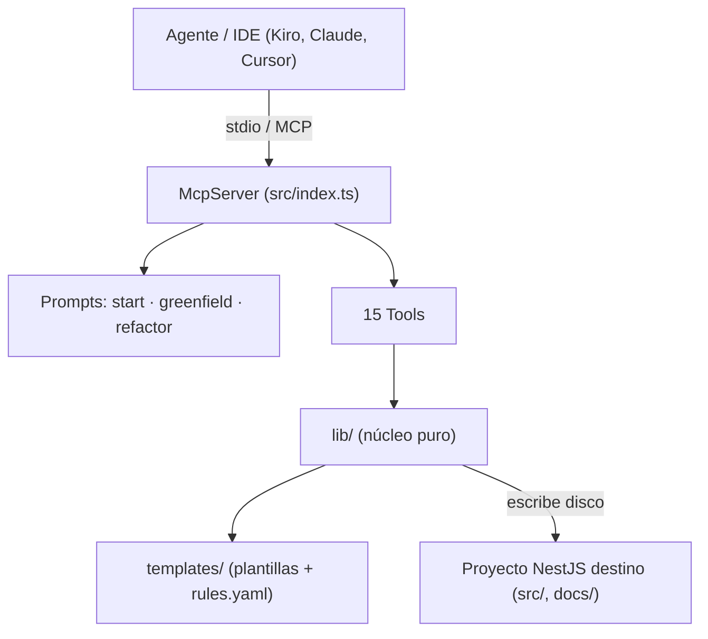
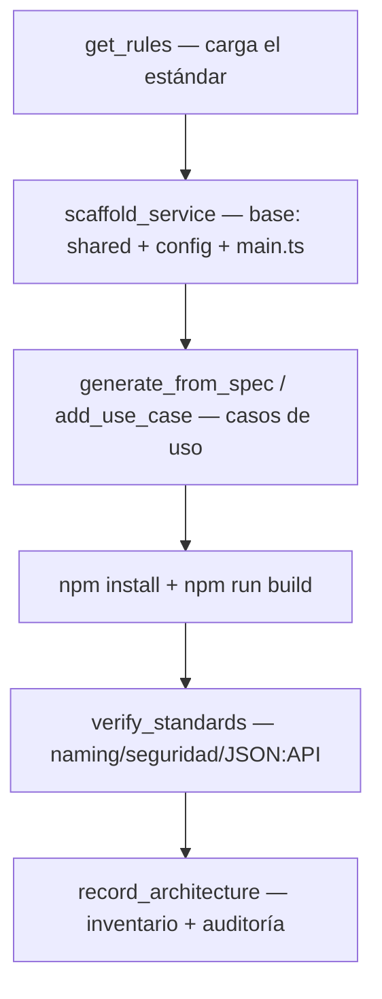
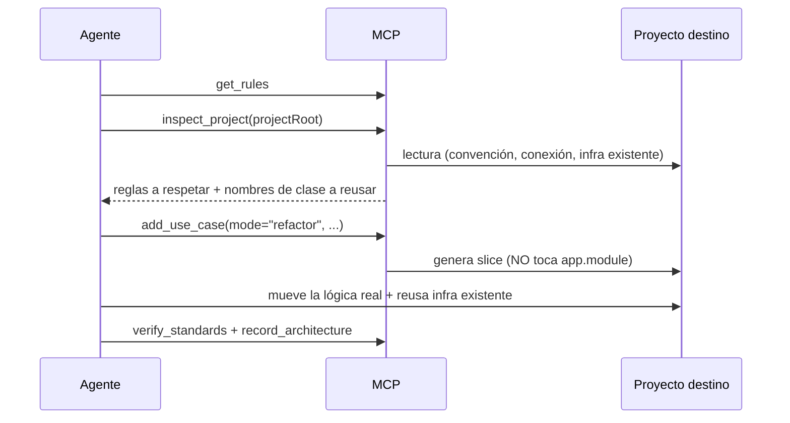
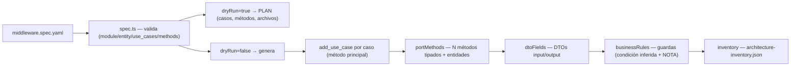

# midd-nestjs-hexagonal-architecture-mcp

> **Estado: híbrido en uso.** Combina `midd-hexagonal-nestjs-mcp` (generador determinista) con las guidelines, el flujo agéntico y el escáner de
> `lib-midd-mcp-architecture`. Las decisiones, el porqué de cada regla, lo que ya se verificó y lo que falta están en [`docs/DESIGN.md`](docs/DESIGN.md).
> Donde este README contradiga a `DESIGN.md` o a `templates/rules.yaml`, mandan esos dos. En particular: la ruta `/{prefijo}/api/v{N}/{recurso}`,
> CORS con `*` por defecto y restringible por `CORS_ALLOWED_ORIGINS`, y los tres controles de rate limit más el correlation ID, que son obligatorios.


Servidor **MCP** (Model Context Protocol) del área Middleware que **genera y verifica microservicios NestJS** con arquitectura **hexagonal**, contrato **JSON:API** y las **cabeceras de seguridad obligatorias**. Cualquier agente/IDE compatible (Kiro, Claude, Cursor, etc.) lo consume para crear servicios nuevos o refactorizar servicios existentes **apegados al estándar del área**, de forma agnóstica de dominio.

> Es la migración de la skill `middleware-hexagonal-nestjs` + su dataset de plantillas a un servidor MCP. La fuente de verdad del estilo es el repo canónico `midd-pf-enrollment`.

---

## Tabla de contenidos

1. [Descripción](#descripción)
2. [Arquitectura](#arquitectura)
3. [Diagramas](#diagramas)
4. [Capacidades](#capacidades)
5. [Stack tecnológico](#stack-tecnológico)
6. [Instalación](#instalación)
7. [Variables de entorno](#variables-de-entorno)
8. [Herramientas MCP (la "API")](#herramientas-mcp-la-api)
9. [Documentación interna](#documentación-interna)
10. [Testing](#testing)
11. [DevOps](#devops)
12. [Comandos](#comandos)
13. [Buenas prácticas](#buenas-prácticas)
14. [Mejoras sugeridas](#mejoras-sugeridas)
15. [Licencia](#licencia)

---

## Descripción

Este proyecto **no es un backend HTTP**: es un **servidor MCP sobre stdio** que escribe archivos directamente en un proyecto NestJS destino (modo A, "escribe disco"). Su "API" son **15 herramientas** (tools) y **3 prompts** (flujos) que un agente invoca para:

- **Crear** un microservicio NestJS hexagonal nuevo (greenfield) completo y funcional.
- **Refactorizar** un NestJS existente a arquitectura hexagonal, respetando su convención.
- **Generar módulos desde un spec declarativo** (`middleware.spec.yaml`), agnóstico de dominio.
- **Verificar** estándares (naming, seguridad, JSON:API) y **dejar memoria** por repo (inventario + auditoría).

El principio rector: **agnóstico de dominio, opinado en calidad**. El `module`/`entity`/`use_cases` los define el usuario; el MCP aporta la forma hexagonal, el naming, los puertos, el JSON:API y la seguridad, destilados del repo canónico.

---

## Arquitectura

El MCP es un proceso Node (ESM) que registra herramientas y prompts contra el `McpServer` del SDK oficial y se comunica por **stdio**. Internamente se separa en tres capas:

| Capa | Carpeta | Responsabilidad |
|------|---------|-----------------|
| **Entrypoint** | `src/index.ts` | Arranca el servidor, registra las 15 tools y los 3 prompts, conecta el transporte stdio. |
| **Tools** | `src/tools/` | Cada herramienta MCP: valida inputs (zod), orquesta la lib y devuelve un reporte de texto. |
| **Lib (núcleo)** | `src/lib/` | Lógica pura: sustitución de placeholders, materialización de plantillas, parcheo idempotente de módulos, parser de spec, inferencia de reglas, inventario. |
| **Dataset** | `templates/` | Las plantillas (capa `shared`, config, `_domain-slice`), `rules.yaml` y el template del spec. Se empaqueta con el servidor. |

**Patrón de generación:** las plantillas usan **placeholders case-sensitive** (`__Caso__`, `__caso__`, `__CASO__`, `__Request__`, `<sharedRoot>`, …) que se sustituyen por los nombres de negocio. Para lo que no se puede resolver con sustitución 1:1 (p.ej. N métodos por puerto, merge de casos, wiring SP), hay **enriquecedores programáticos** que parchean el código generado de forma **idempotente y quirúrgica** (anclados a marcas estables, nunca tocan lo ajeno).

```
src/
├── index.ts                 # servidor MCP: registra 15 tools + 3 prompts (stdio); envuelve con withKit las que trabajan sobre un repo
├── prompts.ts               # flujos guía: start, scaffold_greenfield, refactor_to_hexagonal
├── lib/
│   ├── dataset.ts           # localiza/lee plantillas y materializa árboles en el destino
│   ├── placeholders.ts      # sustitución case-sensitive + mapa de marcadores
│   ├── adapters.ts          # tipos de adapter (typeorm | sp | http) y la llamada HTTP del adapter de API externa
│   ├── engines.ts           # motores (mssql | postgres | mysql | none): driver, puerto, opciones de TypeORM, dialecto de SP
│   ├── connections.ts       # conexiones: nombre por motor, creación completa, detección en refactor
│   ├── moduleMerge.ts       # merge del 2º/3er caso en los módulos del dominio existente
│   ├── spWiring.ts          # wiring quirúrgico del adapter SP (preserva forFeature)
│   ├── httpWiring.ts        # wiring del adapter de API externa (config, Joi, .env.example, catálogo de errores)
│   ├── portMethods.ts       # enriquece puertos inbound/outbound a N métodos + entidades
│   ├── spec.ts              # parser + validador del middleware.spec.yaml
│   ├── businessRules.ts     # materializa reglas de negocio como guardas (condición inferida + NOTA)
│   ├── dtoFields.ts         # pobla DTOs input/output y entidades request/response desde el spec
│   ├── errorCodes.ts        # códigos PREFIJO-SLUG-NNN: 001-999, secuencia por prefijo
│   ├── caseErrors.ts        # entradas de error de un caso que se suma a un dominio que ya existe
│   ├── envFile.ts           # .env.example por secciones
│   ├── env.ts               # .env.example derivado del joiSchema
│   ├── apiDocs.ts           # documentación leída del código (contrato, diagramas, Postman, arquitectura)
│   ├── inventory.ts         # inventario (architecture-inventory.json) + auditoría (docs/audits)
│   ├── learnings.ts         # aprendizaje por repo (consultivo; docs/mcp-learnings.json)
│   ├── agenticKit.ts        # kit de agentes: instalación, actualización y revisión automática
│   ├── inspect.ts           # descubrimiento de solo lectura del proyecto (refactor)
│   └── schemas.ts           # inputs zod compartidos
└── tools/
    ├── scaffold.ts          # scaffold_service
    ├── addUseCase.ts        # add_use_case (vertical slice; greenfield y refactor)
    ├── generateFromSpec.ts  # generate_from_spec (un módulo desde el spec)
    ├── addAuthorization.ts  # add_authorization
    ├── apiDocs.ts           # generate_api_docs
    ├── architecture.ts      # record_architecture (inventario + auditoría)
    ├── learnings.ts         # get_learnings, record_decision
    ├── agentic.ts           # install_agentic_kit, get_flow
    ├── support.ts           # get_rules, inspect_project, verify_standards, list_templates, get_template
    └── kit.ts               # withKit: instala el kit de agentes antes de las tools que trabajan sobre un repo
templates/
├── rules.yaml                       # cerebro de calidad agnóstico (lo devuelve get_rules)
├── middleware.spec.template.yaml    # plantilla del spec declarativo
├── config/                          # base del proyecto NestJS generado + enforcement (verify-standards, eslint, Dockerfile...)
├── shared/                          # capa transversal (JSON:API, errores, logger, config, seguridad, health, utils)
├── database/                        # módulo y opciones de TypeORM por motor
├── authorization/                   # autorización opt-in del borde HTTP
├── agentic/                         # agentes del kit (generator, worker, auditor) y sección de AGENTS.md
└── _domain-slice/                   # plantilla de un caso de uso hexagonal (adapters typeorm, sp y http)
test/                                # suite con el runner nativo de Node (node:test) + e2e real
```

> **Nota de arquitectura — acoplamiento:** `generate_from_spec` reutiliza `add_use_case` como motor de siembra y luego aplica los enriquecedores (`portMethods`, `dtoFields`, `businessRules`) y el inventario. Es un acoplamiento deliberado y unidireccional (tools → lib), que mantiene el camino imperativo (`add_use_case`) intacto mientras el declarativo (`generate_from_spec`) se construye encima.

---

## Diagramas

### Arquitectura de componentes



### Flujo greenfield (crear servicio desde cero)



### Flujo refactor (NestJS existente → hexagonal)



### Generación declarativa desde spec



---

## Capacidades

### Generación (greenfield)
- `scaffold_service` siembra la **capa `shared` completa** (JSON:API, errores, logger, config + Joi, seguridad, health, utils), los archivos de **config/enforcement** (eslint, prettier, Dockerfile, verify-standards, hooks husky), `main.ts`, `app.module.ts`, un `.gitignore` que excluye `.env` (nunca pisa el del proyecto) y el `.env.example` por secciones derivado del joiSchema.
- **Motor de base de datos:** el agente lo pregunta (`mssql`, `postgres`, `mysql`) y de la respuesta salen el driver, las opciones de TypeORM y el dialecto del stored procedure (mssql `EXEC`, mysql `CALL`; **el área no usa stored procedures en PostgreSQL**, el MCP los rechaza). Con `none` (el servicio no usa base de datos) no se genera ninguna conexión, módulo, variable `DB_*` ni driver.
- **Conexiones:** su nombre no se pregunta, sale del motor (`Mssql`, `Postgres`, `Mysql`); una adicional del mismo motor se numera (`Mssql2`, variables `DB_MSSQL2_*`).

### Vertical slice (greenfield y refactor)
- `add_use_case` genera un caso completo: **puertos inbound/outbound**, domain/application services, adapter, controller JSON:API + DTOs, entidades de dominio, catálogos de error y los módulos del dominio.
- **Tres adapters:** `typeorm` (por defecto), `sp` (stored procedure, opt-in; no con PostgreSQL) y `http` (**API externa** con el `fetch` nativo; no necesita base de datos ni conexión). El adapter `http` declara `<API>_BASE_URL` en la configuración, en Joi y en el `.env.example`, y traduce las respuestas (404 = no encontrado; error o API caída = 502 `EXTERNAL_API_ERROR`).
- **Multi-caso:** al añadir el 2º/3er caso al mismo dominio, **mergea** el caso en los módulos y catálogos existentes de forma idempotente.
- **Refactor:** reutiliza la conexión que el proyecto ya tiene (se detecta; no se pregunta nombre ni motor). Si no tiene ninguna, el MCP **no crea una por su cuenta**: solo con pedido expreso (`crearConexion=true` + motor).

### Generación declarativa (desde spec)
- `generate_from_spec` toma un `middleware.spec.yaml` y genera el módulo. Soporta **casos con N métodos por puerto** con entidades request/response tipadas. **Hexagonal puro:** la firma del método del puerto es siempre `(data: Request)`; el nombre del SP, la URL y el verbo de una API externa son infraestructura y no viajan por el puerto. Materializa **DTOs input/output** y **reglas de negocio** (con condición inferida + NOTA), y actualiza el inventario. `dryRun=true` (default) devuelve el **plan** sin escribir disco.

### Seguridad y borde HTTP (obligatorios)
- Cabeceras de seguridad, rate limit con los tres controles (por IP, concurrencia, tamaño de payload), correlation ID (también hacia APIs externas), CORS por variable, health público (`POST /{api}/api/v1/health`), errores del parser con el sobre del área y solo `POST` con `application/vnd.api+json`.
- **Autorización** opt-in (`add_authorization`): puerto agnóstico + Guard global, secure-by-default y fail-closed. El agente siempre pregunta.
- Sin `axios` (se usa `fetch`) y sin `uuid` (se usa `crypto`).

### Textos de los errores
- El MCP escribe el `message`, el `title` y el `suggestedActions` de cada error **en español, a partir de la entidad** (`LockType` → "Lock type no encontrado.", "No se encontró lock type con los parámetros enviados."), también para un caso que se suma a un dominio existente y para el error de API externa. Es una suposición razonable: la persona la corrige si no se apega al caso. `verify_standards` avisa con `ERROR_CATALOG_PLACEHOLDER` si un catálogo conserva el texto de plantilla.

### Códigos de error
- Formato `<PREFIJO>-<SLUG>-<NNN>`, por ejemplo `CATALOG-PRODUCTNOTFOUND-001`. El número va de 001 a 999 y es una secuencia **por prefijo** que asigna el MCP leyendo el código existente: dos errores nunca comparten número.

### Documentación de la API
- `generate_api_docs` lee el código y escribe el contrato por módulo, un diagrama Mermaid de secuencia por módulo y el índice; opcionalmente la colección de Postman y `docs/ARCHITECTURE.md` (`architecture-beta`). Se mantiene al día en cada generación.

### Verificación y descubrimiento
- `verify_standards` corre el verificador del servicio generado con **reglas de ID estable**: naming, seguridad HTTP, correlation ID, `@Version`, `.env.example` y defaults de Joi, autorización, health, conexiones de BD, SP declarado, reglas de código (sin `console.log`, `process.env` directo, `any`, dinero como float, HTTP en el core...), dependencias prohibidas, documentación desactualizada, códigos de error repetidos y `.env` sin ignorar por git.
- `inspect_project`: descubrimiento de **solo lectura** del proyecto destino (convención de carpetas, forma de la conexión TypeORM, infra transversal a reusar con sus **nombres de clase**, nombre que tomaría una conexión nueva).

### Cuántas preguntas hace el agente
En una API nueva, tres momentos:
1. **Un solo mensaje con lo general de la API:** prefijo de la API, prefijo de errores, base de datos (mssql, postgres, mysql o ninguna), autorización, Postman y `ARCHITECTURE.md`.
2. **Por caso de uso:** "qué hace, qué recibe y qué devuelve". De ahí el agente deduce si los datos salen de la base de datos, de una API externa o de un stored procedure, y solo pregunta el dato que falta de ese caso (nombre, verbo y ruta de la API; nombre del SP). Con "ninguna" base de datos, todos los casos son de API externa.
3. **Los valores reales del entorno** (host, usuario, URLs), al preparar el servicio.

No pregunta la conexión, los números de error, CORS, los límites de peticiones, el health, las rutas, la complejidad (nivel 0), el esquema ni reglas que no mencionaste: lo supone y lo lista como TODO al final.

### Memoria por repo y agentes
- `record_architecture`: inventario `docs/architecture-inventory.json` (una entrada por módulo, **sin tocar las de otros**) + auditoría `docs/audits/<module>-<fecha>.md`.
- `get_learnings` / `record_decision`: memoria **consultiva** por repo (prefijos, conexiones, decisión de autorización, errores que se repiten); nunca cambia las reglas base.
- **Kit de agentes** (`middleware-generator`, `middleware-gen-worker`, `middleware-auditor`): se instala solo la primera vez que una herramienta trabaja sobre un repo (ver más abajo). El agente prepara el entorno: corre `npm install`, crea el `.env` con los valores que le da el usuario y no repite contraseñas.

---

## Stack tecnológico

| Componente | Tecnología | Versión | Rol |
|------------|-----------|---------|-----|
| Runtime | Node.js | ≥ 18 (probado en 22) | Ejecuta el servidor MCP (ESM). |
| Lenguaje | TypeScript | ^5.4 | Código fuente (`src/`), compila a `dist/`. |
| Protocolo | `@modelcontextprotocol/sdk` | ^1.0.4 | `McpServer` + transporte stdio. |
| Validación | `zod` | ^3.23.8 | Esquemas de input de cada tool. |
| Parsing | `yaml` | 2.6.1 (pinned) | Lee el `middleware.spec.yaml`. |
| Tests | `node:test` | nativo | Suite sin dependencias extra. |
| Tipos | `@types/node` | ^20.11 | Tipos de Node para el build. |

> Las dependencias se documentan tal cual están en `package.json`. El MCP es deliberadamente ligero: solo SDK + zod + yaml en runtime.

---

## Instalación

```bash
npm install
npm run build
```

El dataset de plantillas vive en `templates/` y se empaqueta con el servidor (campo `files` del `package.json`: `dist` + `templates`).

### Conectar a Kiro

Añade el servidor a la config MCP. Workspace: `.kiro/settings/mcp.json`. Usuario: `~/.kiro/settings/mcp.json`.

```json
{
  "mcpServers": {
    "midd-nestjs-hexagonal-architecture": {
      "command": "node",
      "args": ["C:/Propuestas/midd-nestjs-hexagonal-architecture-mcp/dist/index.js"],
      "disabled": false,
      "autoApprove": ["get_rules", "get_flow", "get_learnings", "list_templates", "get_template", "inspect_project"]
    }
  }
}
```

Solo las herramientas de lectura van en `autoApprove`; las que escriben archivos piden confirmación.

**Actualizar el MCP:** `npm run build` y reconectar el servidor desde la vista MCP de Kiro. El repo no necesita nada más.

> Este MCP comparte nombres de herramientas (`scaffold_service`, `add_use_case`, `get_rules`...) con `midd-hexagonal-nestjs` y `midd-architecture`. Si los tienes activos a la vez, desactiva los otros para que el agente no llame a uno equivocado.

### Instalación automática de los agentes

No hace falta pedir `install_agentic_kit`. La primera herramienta que trabaja sobre un repo (`scaffold_service`, `add_use_case`, `generate_from_spec`, `add_authorization`, `inspect_project`) revisa si el kit está y, si no, lo instala antes de seguir:

| Situación del repo | Qué hace el MCP |
|---|---|
| No tiene el kit | Lo instala: `.kiro/agents/middleware-generator.md`, `middleware-gen-worker.md`, `middleware-auditor.md`, `agentic/templates/` y la sección del MCP en `AGENTS.md`. Avisa qué agente seleccionar. |
| Tiene el kit de una versión anterior | Lo actualiza y conserva los modelos que el equipo haya puesto en los agentes. |
| Ya está al día | No escribe nada. `scaffold_service` e `inspect_project` solo recuerdan qué agente usar. |
| Hay un agente con esos nombres que no instaló este MCP | No toca nada y lo dice (los tres agentes van como conjunto). Para reemplazarlos: `install_agentic_kit` con `overwrite=true`. |

**El agente del chat no lo puede fijar un MCP.** Kiro lo elige en el selector de agentes de la barra del chat (junto al selector de modelo); el agente aparece ahí al guardarse el archivo, y si no se ve hay que recargar la ventana. Según el changelog de Kiro IDE 1.0, ese mismo selector permite dejar un agente preferido que persiste entre reinicios. Un chat que ya empezó con el agente por defecto sigue con él hasta que se cambie.

Para desactivar la instalación automática, en la configuración del servidor MCP:

```json
"env": { "MIDD_NESTJS_AUTO_KIT": "off" }
```

---

## Variables de entorno

### Del servidor MCP

| Variable | Valores | Descripción |
|----------|---------|-------------|
| `MIDD_NESTJS_AUTO_KIT` | `off` / `0` / `false` / `no` | Desactiva la instalación automática del kit de agentes. Por defecto está activa. Se define en `env` de la config MCP. |

### Del servicio que el MCP genera

Derivadas del `joiSchema` (fuente de verdad, que alimenta el `.env.example`). Todo lo que tiene valor por defecto lo aplica Joi si la variable no está configurada.

| Variable | Tipo | Requerida | Descripción |
|----------|------|-----------|-------------|
| `PORT` | number | no (3000) | Puerto HTTP. |
| `API_CONTEXT` | string | **sí** | Prefijo de la API (`prefijoApi`): los endpoints quedan en `/<prefijo>/api/v1/{recurso}`. |
| `CORS_ALLOWED_ORIGINS` | string | no (`*`) | Orígenes permitidos separados por coma. `*` es el valor por defecto (middleware servidor-a-servidor); se restringe con la variable, sin tocar código. |
| `RL_MAX_REQUESTS_PER_WINDOW` / `RL_WINDOW_SECONDS` | number | no (150 / 5) | Peticiones por IP en la ventana. Al pasarse: 429. |
| `RL_MAX_CONCURRENT_PER_IP` | number | no (20) | Conexiones simultáneas por IP. |
| `RL_MAX_PAYLOAD_BYTES` / `RL_MAX_JSON_PAYLOAD_BYTES` | number | no (8 MB / 2 MB) | Tamaño máximo del cuerpo. Al pasarse: 413. |
| `RL_CACHE_TTL_MS` / `RL_CACHE_MAX_ENTRIES` | number | no (600000 / 100000) | Cuánto y cuántas IPs recuerda el contador. |
| `RL_TRUSTED_PROXIES` | string | no (rangos privados) | Proxies de confianza para leer la IP real. |
| `DB_<CONEXION>_HOST` / `_PORT` / `_USERNAME` / `_PASSWORD` / `_NAME` | string / number | **sí**, si hay conexión | Por conexión (p.ej. `DB_MSSQL_HOST`). El puerto por defecto depende del motor: mssql 1433, postgres 5432, mysql 3306. |
| `AUTHORIZATION_API_URL` | URL | solo con autorización | API de autorización. |
| `<API>_BASE_URL` | URL | condicional | URL base de cada API externa consumida por un caso `http` (p.ej. `EXCHANGE_RATES_BASE_URL`). Sin ella el servicio no arranca. |
| `<NOMBRE_SP>_SP` | string | condicional | Se añade por cada caso con adapter `sp`. |

`.env.example` generado (agrupado por temas; cada herramienta mete su variable en su sección):

```dotenv
# --- Server ---
PORT=3000
API_CONTEXT=midd-catalog

# --- CORS ---
CORS_ALLOWED_ORIGINS=*

# --- Ratelimit ---
RL_MAX_REQUESTS_PER_WINDOW=150
# ... las demás RL_*

# --- Database connection 'Mssql' (SQL Server) ---
DB_MSSQL_HOST=localhost
DB_MSSQL_PORT=1433
DB_MSSQL_USERNAME=sa
DB_MSSQL_PASSWORD=changeme
DB_MSSQL_NAME=MyDatabase

# --- Authorization ---
AUTHORIZATION_API_URL=...

# --- External APIs ---
EXCHANGE_RATES_BASE_URL=https://api.example.com
```

> **El `.env` real lo crea el agente**, a partir del `.env.example` y con los valores que le da el usuario (sin repetir contraseñas). El `.gitignore` generado lo excluye y `verify_standards` falla con `ENV_NOT_IGNORED` si un `.env` no está ignorado por git.

---

## Herramientas MCP (la "API")

El equivalente a "endpoints" de este servidor. Cada tool recibe un input validado con zod y devuelve un reporte de texto.

### `get_rules`
Devuelve `rules.yaml`: el **cerebro de calidad agnóstico** (arquitectura hexagonal, naming, puertos inbound/outbound multi-método, DTOs JSON:API, acceso a datos, reglas de negocio, errores, seguridad, complejidad) con snippets destilados del canon. **Debe leerse antes de generar o refactorizar.**
- **Input:** _(ninguno)_

### `scaffold_service`
Genera la base de un servicio NestJS hexagonal nuevo.
- **Input:** `projectRoot`, `conexion?` (opcional: por defecto el nombre del motor), `motor` (`mssql`\|`postgres`\|`mysql`\|`none`, obligatorio: el agente lo pregunta; `none` = sin base de datos, no se genera ninguna conexión), `prefijoApi` (kebab-case), `prefijoError` (MAYÚSCULAS), `overwrite?`
- **Escribe:** `src/shared/**`, config/enforcement, `main.ts`, `app.module.ts`, `.env.example`.

### `add_use_case`
Genera un caso de uso completo (vertical slice).
- **Input:** `projectRoot`, `dominio`, `caso`, `entidad`, `metodo`, `param`, `request?`, `accion`, `prefijoError`, `conexion?` (opcional), `crearConexion?` (solo refactor, si el usuario la pidió expresamente), `motor?` (obligatorio solo si la conexión es nueva), `adapterType` (`typeorm`\|`sp`\|`http`), `nombreSp?`, `apiExterna?`, `rutaApi?`, `metodoHttp?`, `envVarSp?`, `mode` (`greenfield`|`refactor`), `connectionStyle` (`named`|`default`), `infraStyle` (`dataset`|`project`), `infraRoot?`, `overwrite?`
- **Nota:** SP requiere `nombreSp` (opt-in). En `refactor` no toca `app.module`.

### `generate_from_spec`
Genera un módulo completo desde un `middleware.spec.yaml`.
- **Input:** `projectRoot`, `specPath`, `mode` (`greenfield`|`refactor`), `dryRun` (default `true`), `overwrite?`
- **dryRun=true:** devuelve el plan (casos, métodos, archivos) sin escribir. **dryRun=false:** genera + actualiza el inventario.

### `record_architecture`
Registra el módulo en el inventario y escribe su auditoría.
- **Input:** `projectRoot`, `specPath`, `compliance?`, `buildStatus?`, `decisions?`, `writeAuditFile?` (default `true`)

### `generate_api_docs`
Genera la documentación de la API **leyendo el código real** (controllers, DTOs y catálogos de error). Determinista: el mismo código da los mismos archivos.
- **Input:** `projectRoot`, `modules?` (por defecto todos), `postman?` (default `false`), `architecture?` (default `false`)
- **Siempre escribe:** `src/<modulo>/contracts/<modulo>.api.md` (contrato: endpoints, campos, errores, curl), `src/<modulo>/diagrams/<modulo>.flow.mmd` (Mermaid `sequenceDiagram` por módulo) y `docs/api/README.md` (índice).
- **Opt-in (el agente pregunta):** `postman=true` crea `docs/api/middleware.postman_collection.json` (una colección v2.1, una carpeta por módulo; al fusionar solo se reemplaza la carpeta del módulo). `architecture=true` crea `docs/ARCHITECTURE.md` con un diagrama Mermaid `architecture-beta` (11.1+; las líneas `align` requieren 11.16+).
- **Se mantiene al día:** `add_use_case`, `generate_from_spec` y `record_architecture` regeneran el contrato y el diagrama del módulo, y refrescan Postman y `ARCHITECTURE.md` si ya existen. `verify_standards` avisa (WARN, no bloquea) con `API_DOCS_MISSING` / `API_DOCS_STALE`.

### `add_authorization`, `record_decision`, `get_learnings`, `install_agentic_kit`, `get_flow`
Ver `docs/DESIGN.md`: autorización opt-in del borde HTTP, memoria por repo (consultiva), kit de agentes y procedimiento de cada flujo.

### `inspect_project`
Descubrimiento de solo lectura del proyecto destino (refactor).
- **Input:** `projectRoot`
- **Devuelve:** convención de carpetas/case, forma de conexión TypeORM, infra transversal existente + nombres de clase, módulos, `infraRoot`.

### `verify_standards`
Corre la verificación de estándares sobre el proyecto destino.
- **Input:** `projectRoot`, `installScript?` (default `true`)
- **Devuelve:** reporte; falla (isError) si hay errores bloqueantes.

### `list_templates` / `get_template`
Inspeccionar el dataset.
- `list_templates` — **Input:** `subdir` (`shared`|`config`|`_domain-slice`|`all`).
- `get_template` — **Input:** `relativePath`.

### Prompts (flujos guía)
- `start` — desambigua greenfield vs refactor según el estado del workspace.
- `scaffold_greenfield` — guía la creación de un servicio nuevo paso a paso.
- `refactor_to_hexagonal` — guía la conversión de un NestJS existente a hexagonal.

---

## Documentación interna

### El spec declarativo (`middleware.spec.yaml`)
Agnóstico de dominio: `module`, `entity` y `use_cases` los define el usuario. Un caso de uso declara **N métodos** por puerto, cada uno con su entidad request y response (firma canónica `(data: <Request>): Promise<<Response>>`). El parser (`spec.ts`) valida naming (kebab/Pascal/camel/MAYÚSCULAS), exige al menos un caso con un método, exige `sp` cuando `adapter="sp"`, y obliga a declarar reglas o `none: true` — **el MCP no inventa reglas**.

### Enriquecedores (parcheo idempotente)
- **`moduleMerge.ts`** — registra casos adicionales en los módulos del dominio (controller, adapter, providers, tokens, `forFeature`, `app.module`) balanceando corchetes y evitando duplicados.
- **`spWiring.ts`** — wiring SP quirúrgico: apunta al `.sp.adapter`, quita del `forFeature` **solo** la entidad del caso SP (preserva las demás), y registra el SP en config/joi/`.env`.
- **`portMethods.ts`** — añade N métodos tipados a puertos/domain service/adapter y crea las entidades `*.entity.ts` faltantes.
- **`httpWiring.ts`** — wiring del adapter de API externa: apunta los módulos al `.http.adapter`, declara `<API>_BASE_URL` (config + Joi `.uri().required()` + `.env.example`) y la entrada `EXTERNAL_API_ERROR` del catálogo.
- **`caseErrors.ts` / `errorCodes.ts`** — un caso nuevo en un dominio existente agrega sus entradas a los catálogos de error, y cada código toma el siguiente número libre del prefijo.
- **`businessRules.ts`** — materializa reglas como guardas con `GenericException`; infiere la condición por patrón (obligatorio, enum, unicidad, 404, branching) y estampa una **NOTA** de que es una aproximación a revisar.

### Convención de nombres
Carpeta de dominio en lowercase, clases en PascalCase, puertos `I<Caso>Service` (inbound) / `I<Caso>Repository` (outbound), entidades `*.entity.ts`, tokens de inyección en MAYÚSCULAS. Sustitución de placeholders **case-sensitive**.

---

## Testing

Suite con el **runner nativo de Node** (`node:test`), sin dependencias extra. Se ejecuta sobre el `dist` compilado.

```bash
npm test          # rápida (~1 min, sin red): tsc && node --test "test/**/*.test.mjs"
npm run test:e2e # genera, instala, compila y arranca un servicio real (necesita red la 1ª vez)
```

| Archivo | Cubre |
|---------|-------|
| `test/spec.test.mjs` | Validación del spec: acepta válido, acumula errores, exige `sp`/reglas/casos. |
| `test/businessRules.test.mjs` | Inferencia de guardas (obligatorio/enum activas; unicidad/404 comentadas; no-reconocible → andamiaje). |
| `test/inventory.test.mjs` | Envelope, agregar 2º módulo sin tocar el 1º, reemplazo de entrada, auditoría. |
| `test/placeholders.test.mjs` | Derivación de case, `__Request__`, sustitución case-sensitive, `<ConexionArg>`. |
| `test/scaffold.e2e.test.mjs` | Genera servicios y exige que `verify-standards` pase limpio; una mutación por cada regla bloqueante (seguridad, ruta, dependencias, autorización, health, SP). |
| `test/database.test.mjs` | Motores (mssql, postgres, mysql): perfiles, dialecto de SP con un DataSource falso, conexiones adicionales, el motor es obligatorio. En PostgreSQL no se aceptan stored procedures. |
| `test/errorTexts.test.mjs` | Textos de error en español desde la entidad (también al sumar un caso a un dominio existente y en el error de API externa) y aviso del verificador por texto de plantilla. |
| `test/connectionName.test.mjs`, `test/noDatabase.test.mjs` | Nombre de la conexión por motor, reutilización, refactor (detecta, no crea sin pedido expreso) y servicio sin base de datos. |
| `test/httpAdapter.test.mjs` | Adapter de API externa: cableado sin base de datos, verbos GET/POST/PUT, config/Joi/.env, mezcla con TypeORM, spec, refactor, documentación. |
| `test/errorCodes.test.mjs` | Códigos `PREFIJO-SLUG-NNN`: secuencia por prefijo, 001-999, agotamiento, capa compartida de 3 dígitos y reglas del verificador. |
| `test/envFile.test.mjs`, `test/environment.test.mjs` | `.env.example` por secciones y defaults de Joi; pasos dirigidos al agente, `.gitignore` y `ENV_NOT_IGNORED`. |
| `test/apiDocs.test.mjs` | Documentación generada desde el código: contrato, diagrama, fusión de Postman, `architecture-beta`, refresco automático y avisos del verificador. |
| `test/agentic.test.mjs`, `test/autoKit.test.mjs` | Kit de agentes: instalación idempotente, `AGENTS.md` ajeno/roto, modelos; instalación automática por el protocolo MCP (instala, actualiza conservando modelos, respeta agentes ajenos, opt-out). |
| `test/learnings.test.mjs` | Aprendizaje por repo: captura, saneamiento de texto hostil, y que el verificador no lo lee. |
| `test/e2e/compile.e2e.mjs` | **End-to-end real** (`npm run test:e2e`): genera módulos (SP y TypeORM) + autorización, `npm install`, `npm run build`, tests y lint del servicio generado, `verify-standards`, y lo arranca para probarlo por HTTP (health, cabeceras, 401/403/200, 413, 400, 429, defaults de Joi sin variables). Además un servicio **sin base de datos** que consume una API externa falsa (200, 404, 502, API caída, propagación del correlation ID). |

**Estado actual:** 219 tests rápidos y 25 comprobaciones end-to-end, todos en verde. Lo que **no** está probado: postgres y mysql contra motores vivos (solo con un DataSource falso), y la conversación del agente con modelos reales dentro de Kiro.

---

## DevOps

- **Build:** `tsc` (TypeScript → `dist/`, ESM `Node16`). Configuración en `tsconfig.json` (target ES2022, `strict: true`).
- **Empaquetado:** `package.json` → `bin: midd-nestjs-hexagonal-mcp`, `files: [dist, templates]`. El dataset viaja con el paquete.
- **Transporte:** stdio (`StdioServerTransport`). `stdout` reservado para el protocolo; los logs van a `stderr`.
- **CI/CD propio del MCP:** _pendiente de confirmar_ — no se detectó pipeline (`.github/`, `.gitlab-ci.yml`) ni Dockerfile para el propio servidor en el repo. (El `Dockerfile` que existe está en `templates/config/` y pertenece al **servicio generado**, no al MCP.)
- **`.gitignore`:** ignora `node_modules`, `dist`, `*.log`, `.DS_Store`.
- **Repo del MCP:** hoy solo tiene `git init` (sin commits ni remoto).

> **Seguridad en los servicios generados** (no en el MCP): `main.ts` fuerza Helmet, HSTS (1 año), CSP, `X-Content-Type-Options`, Referrer-Policy, Permissions-Policy, `Cache-Control: no-store`. CORS vale `*` por defecto y se restringe con `CORS_ALLOWED_ORIGINS` (ver Variables de entorno).

---

## Comandos

| Comando | Qué hace |
|---------|----------|
| `npm install` | Instala dependencias. |
| `npm run build` | Compila `src/` → `dist/` con `tsc`. |
| `npm start` | Arranca el servidor MCP (`node dist/index.js`). |
| `npm run dev` | Compila en modo watch (`tsc --watch`). |
| `npm test` | Compila y corre la suite rápida `node:test`. |
| `npm run test:e2e` | Genera un servicio real, lo instala, compila, prueba y arranca. Deja las dependencias en caché en la carpeta temporal (`midd-e2e-workspace`). |

---

## Buenas prácticas

- **Agnóstico de dominio, opinado en calidad:** el MCP nunca hornea un dominio; el usuario define `module`/`entity`, el MCP aporta la forma y la calidad.
- **El MCP no inventa reglas ni columnas:** las reglas de negocio y el schema se extraen del usuario/spec; lo generado lleva NOTA cuando es una aproximación.
- **Parcheo idempotente y quirúrgico:** los enriquecedores nunca duplican ni tocan código de otros casos/módulos.
- **Leer `get_rules` (y el inventario) antes de generar:** así todo sale consistente y no se duplican módulos.
- **`dryRun` por defecto:** revisa el plan antes de escribir disco.
- **El agente ejecuta, el usuario decide:** `npm install`, el `.env` y el arranque los hace el agente; al usuario solo se le piden los valores. Nunca se repiten contraseñas ni tokens.
- **El MCP no cambia el agente del chat:** lo elige el usuario en el selector de Kiro; el MCP instala los agentes y avisa cuál usar.
- **stdout limpio:** en un servidor MCP stdio, nunca escribas a `stdout` fuera del protocolo (usa `stderr`).

---

## Mejoras sugeridas

- CI propio del MCP (lint + build + test en cada push).
- Probar postgres y mysql contra motores vivos (hoy solo con un DataSource falso).
- Autenticación en el adapter de API externa (hoy deja un TODO; las credenciales deben salir de `ConfigurationVariables`).
- Confirmar el formato vigente de los agentes de Kiro (`permissions` en lugar de `allowedTools`/`toolsSettings`) y migrarlos si hace falta.

---

## Licencia

Software propietario de **Macropay**. Copyright (c) 2026 Macropay. Todos los derechos reservados.

Este MCP, sus plantillas, sus reglas y su documentación son de uso interno de Macropay (empleados y colaboradores autorizados). No se concede ningún derecho de copia, modificación, distribución ni uso fuera de Macropay sin autorización previa y por escrito. Ver [LICENSE](LICENSE).
